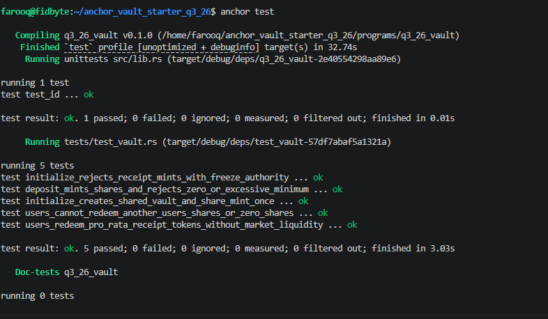
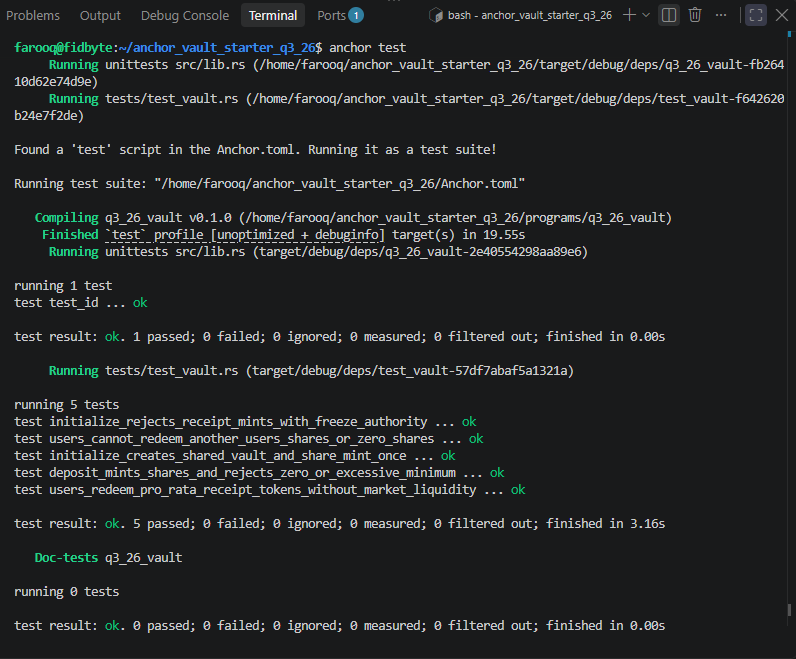

# Anchor Vault

An Anchor program for pooling a transferable SPL receipt token and issuing
transferable vault shares. Shareholders can redeem those shares directly for
receipt tokens, without relying on the underlying market having liquidity to
pay out SOL.

> **Prototype:** This repository does not integrate with a specific market,
> create or manage market positions, or convert receipt tokens to SOL. It has
> not been independently audited and is not production-ready.

## How it works

There is one shared vault for each classic SPL receipt mint:

1. **Initialize** creates the vault state PDA, a token account holding receipt
   tokens, and a share mint controlled by the vault state.
2. **Deposit** transfers receipt tokens from a user's existing token account
   and mints shares to their existing share-token account.
3. **Redeem** burns shares and transfers the corresponding receipt tokens to
   the user's existing receipt-token account in the same transaction.

Shares are transferable SPL tokens. Users choose their own redemption amount;
there is no queue, cooldown, or minimum market-liquidity condition in the
receipt-token redemption path. Exiting this vault returns receipt tokens, not
SOL: users can convert those tokens to SOL only if the underlying market
supports a successful redemption.

The program-controlled vault PDA holds pooled receipts, so this is a
**share-based escrow vault**, not strictly non-custodial custody. The program
currently has no strategy, market CPI, admin withdrawal, pause, or oracle
integration.

## Share accounting

For the first deposit, shares are minted one-for-one with the vault's receipt
balance after the transfer. For later deposits, the program uses the amount
received and the vault's pre-deposit balance:

```text
shares_out = received_receipts * share_supply / receipts_before
```

Redemption uses the current vault balance and share supply:

```text
receipts_out = shares_burned * vault_receipts / share_supply
```

Both calculations use checked `u128` intermediates and round down. The final
shares receive all remaining receipt-token dust. Deposits and redemptions take
a caller-supplied minimum output to enforce slippage bounds. A direct token
donation to the vault changes its share price and is reflected in subsequent
deposits and redemptions.

## Scope and compatibility

- Supports the classic SPL Token program only. Token-2022 mints and extensions
  are not supported.
- The receipt mint must be transferable and have no freeze authority. The
  market and receipt mint must be evaluated separately before use.
- Users must create their receipt-token and share-token accounts before calling
  deposit or redeem; the program does not create associated token accounts.
- The original per-user native-SOL vault state remains supported by the legacy
  `withdraw` and `close` instructions. The new receipt-token vault uses a
  separate state PDA and does not migrate legacy SOL positions.

See the [program README](./programs/q3_26_vault/README.md) for instruction
details and rounding behavior.

## Repository layout

```text
programs/q3_26_vault/
├── src/
│   ├── instructions/   # Receipt vault, deposit, redeem, and legacy SOL exits
│   ├── state.rs        # Legacy SOL and shared receipt-vault account state
│   └── lib.rs          # Anchor instruction entry points
└── tests/
    └── test_vault.rs   # LiteSVM tests using the classic SPL Token program
```

## Prerequisites

- Rust toolchain specified in [`rust-toolchain.toml`](./rust-toolchain.toml)
- Solana tools and the Anchor CLI

## Build and test

From the repository root:

```sh
anchor build
cargo test -p q3_26_vault
```

The LiteSVM tests cover vault initialization, share minting, pro-rata in-kind
redemption, slippage protection, and rejection of unauthorized or invalid
operations. They use a test receipt mint and do not exercise an external
market.

## Program address

The program ID configured for localnet is
`FEV3t9iJMwDb2wYFHiaESXoQuDRT3wWuSR8NiQa6bdXS`. Confirm the target cluster,
program ID, upgrade authority, and deployment artifacts before deploying.

## Security

This program handles user assets. Do not deploy it with real funds based only
on the included tests. Obtain an independent security review and verify the
receipt mint's issuer, transfer behavior, market backing, and redemption
conditions. In-kind vault redemption cannot guarantee that the receipt token
itself can be immediately sold or redeemed for SOL.


## Test evidence

Withdraw and Close Instructions Challenge tests pass:




Advanced Extension Challenge tests pass:


